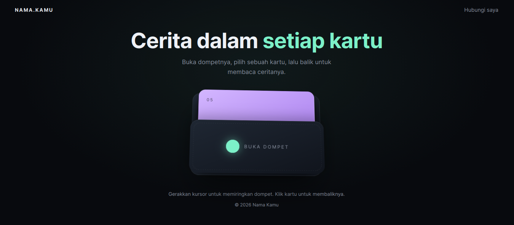
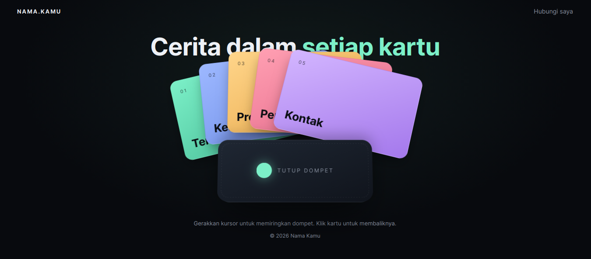

<h1 align="center">
  <br>
  Wallet Portfolio
</h1>

<p align="center">
  <b>Cerita dalam setiap kartu.</b><br>
  Website portofolio personal berbasis HTML dengan kartu 3D interaktif yang keluar dari dompet. 👛✨
</p>

<div align="center">

[](https://andhiirawan.github.io/wallet-portfolio/)


[](https://github.com/andhiirawan/wallet-portfolio/stargazers)


</div>

<p align="center">
  <a href="#-preview">Preview</a> •
  <a href="#-fitur">Fitur</a> •
  <a href="#-memulai">Memulai</a> •
  <a href="#-kustomisasi">Kustomisasi</a> •
  <a href="#-deploy">Deploy</a> •
  <a href="#-roadmap">Roadmap</a> •
  <a href="#-lisensi">Lisensi</a>
</p>

---

## 🖼️ Preview

<table>
  <tr>
    <td align="center" width="50%">
      <br>
      <sub><b>1. Dompet tertutup</b><br>Klik tombol <i>Buka dompet</i> untuk memulai.</sub>
    </td>
    <td align="center" width="50%">
      <br>
      <sub><b>2. Dompet terbuka</b><br>Kartu mengipas keluar, klik kartu untuk membaliknya.</sub>
    </td>
  </tr>
</table>

## ✨ Fitur

- 👛 **Dompet 3D** dengan saku depan, efek `perspective`, dan kilau tombol.
- 🃏 **5 kartu interaktif** (Tentang, Keahlian, Proyek, Pengalaman, Kontak) yang mengipas keluar dari dompet.
- 🔄 **Flip card**: klik kartu untuk membaliknya dan membaca detailnya.
- 🖱️ **Tilt mengikuti kursor**: dompet miring secara halus mengikuti gerakan mouse.
- ⌨️ **Aksesibel**: kartu bisa difokus dan dioperasikan dengan `Enter` / `Spasi`, lengkap dengan `aria-label` dan `aria-expanded`.
- 🌗 **Tema gelap dan terang otomatis** lewat `prefers-color-scheme`.
- 🐢 **Ramah gerakan**: animasi dimatikan saat `prefers-reduced-motion` aktif.
- 📱 **Responsif** dari layar 360px sampai desktop.
- 🪶 **Tanpa dependensi**: satu file HTML, tanpa framework dan tanpa build step.

## 🚀 Memulai

```bash
# 1. Clone repositori
git clone https://github.com/andhiirawan/wallet-portfolio.git
cd wallet-portfolio

# 2. Buka langsung di browser
open index.html          # macOS
xdg-open index.html      # Linux
start index.html         # Windows
```

Atau jalankan server lokal:

```bash
npx serve .
# atau
python3 -m http.server 8080
```

## 🎨 Kustomisasi

Semua konten ada di `index.html`. Setiap kartu adalah satu blok `.card`:

```html
<div class="card"
     style="--i:2; --x:0px; --y:-140px; --r:0deg; --c1:#ffd58a; --c2:#e9a94a"
     tabindex="0" role="button" aria-label="Kartu Proyek">
  <div class="face front"><small>03</small><h3>Proyek</h3></div>
  <div class="face rear">
    <h4>Proyek</h4>
    <p>Tulis proyek pilihanmu di sini.</p>
  </div>
</div>
```

| Variabel | Fungsi |
| --- | --- |
| `--i` | Urutan tumpukan kartu (0, 1, 2, …) |
| `--x`, `--y` | Posisi kartu saat dompet terbuka |
| `--r` | Kemiringan kartu saat terbuka |
| `--c1`, `--c2` | Warna gradasi muka kartu |

**Mengganti warna tema** lewat variabel di `:root`:

```css
:root {
  --bg:  #080a0e;  /* latar */
  --fg:  #eef1f6;  /* teks */
  --acc: #7cf0c8;  /* aksen */
}
```

**Menambah atau mengurangi kartu**: salin satu blok `.card`, ubah `--i`, `--x`, `--y`, `--r`, lalu isi kontennya.

## 🗂️ Struktur Proyek

```text
wallet-portfolio/
├── index.html            # halaman utama (HTML + CSS + JS)
├── favicon.svg           # favicon vektor
├── assets/
│   ├── logo.svg          # logo untuk README
│   ├── icon-180.png      # apple-touch-icon
│   ├── icon-512.png      # ikon besar / PWA
│   ├── screenshot-closed.png
│   └── screenshot-open.png
├── LICENSE
└── README.md
```

## 🌍 Deploy

**GitHub Pages** (gratis):

1. Buka **Settings → Pages**.
2. Pada *Source*, pilih **Deploy from a branch**, lalu branch `main` dan folder `/ (root)`.
3. Simpan, lalu situs aktif di `https://andhiirawan.github.io/wallet-portfolio/`.

**Alternatif**: Netlify, Vercel, atau Cloudflare Pages. Cukup seret folder proyek, tidak perlu build command.

## 🧰 Teknologi

| Bagian | Detail |
| --- | --- |
| Markup | HTML5 semantik |
| Gaya | CSS3 (custom properties, 3D transforms, `prefers-color-scheme`) |
| Interaksi | JavaScript vanilla (tanpa library) |
| Aset | SVG untuk logo dan favicon |

## 🗺️ Roadmap

- [x] Dompet 3D dan kartu yang mengipas keluar
- [x] Flip card dengan keyboard support
- [x] Mode terang dan gelap otomatis
- [ ] Versi React (Vite)
- [ ] Versi Laravel Blade dengan data dari database
- [ ] Suara klik halus (opsional)
- [ ] Mode multi-bahasa (ID/EN)

## 🤝 Kontribusi

Kontribusi, issue, dan ide fitur sangat diterima.

1. Fork repositori ini
2. Buat branch fitur: `git checkout -b fitur/nama-fitur`
3. Commit perubahan: `git commit -m "Tambah fitur ..."`
4. Push: `git push origin fitur/nama-fitur`
5. Buka Pull Request

## 📄 Lisensi

Dirilis di bawah lisensi [MIT](LICENSE). Bebas dipakai dan dimodifikasi, cukup sertakan atribusi.

## 👤 Penulis

**andhiirawan**: [github.com/andhiirawan](https://github.com/andhiirawan)

<p align="center">
  Kalau proyek ini bermanfaat, beri ⭐ ya!<br>
  <sub>Dibuat dengan ☕ dan sedikit sihir CSS.</sub>
</p>
